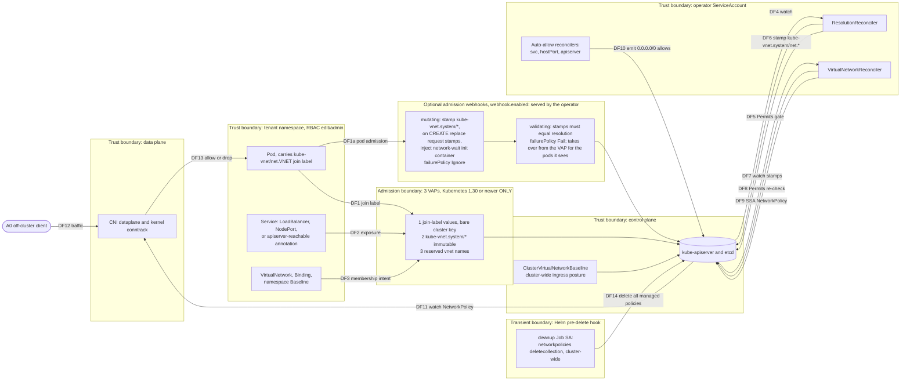
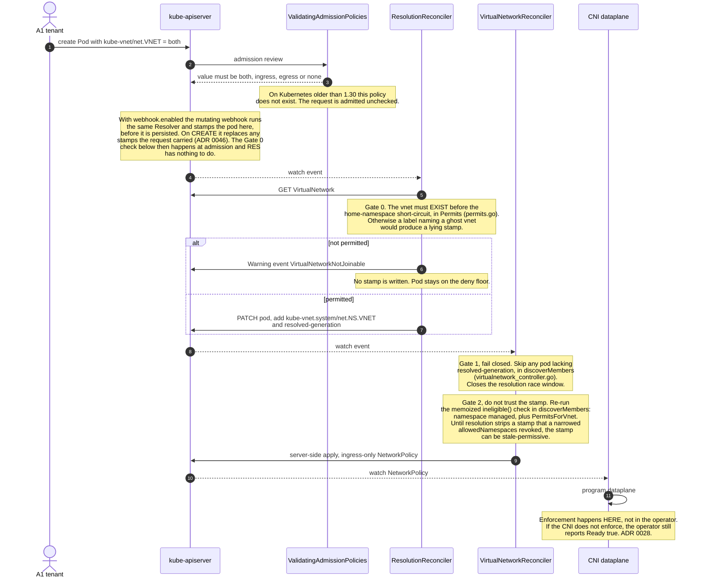

# Threat model (STRIDE)

A structured adversarial analysis of kube-vnet: assets, actors, trust boundaries, data flows, and a findings register. Its companion is [`security.md`](security.md) — that document is the operator-facing security *guide* (RBAC inventory, supply chain, hardening); this one is the *model*.

Every control below cites source (`file:line`) or an ADR. Citations were last re-verified on 2026-11-23 against 0.9.2: the stamp rewrite on pod create ([ADR 0046](../adr/0046-rewrite-stamps-on-pod-create.md)), host-port policies on the containerPort ([ADR 0040](../adr/0040-auto-allow-hostport-pods.md), 2026-11-22 amendment) and release-only signing. If you move code, fix the citations.

**Status**: first formal threat model, 2026-07-09; last updated 2026-11-23. Scope: kube-vnet's own attack surface, including how its images and chart are built and published (§6a). Kubernetes' own boundaries (RBAC, admission, etcd) are assumed sound and are *not* re-litigated here.

---

## 1. Scope and load-bearing assumptions

kube-vnet is a **policy generator**, not an enforcement point. It converts a membership model into `networking.k8s.io/v1` NetworkPolicy objects. Everything downstream of that is Kubernetes and the CNI.

Three assumptions carry the entire model. Each fails **silently** — that is what makes them worth stating first.

| # | Assumption | If false | Signal you get |
|---|---|---|---|
| A-1 | **The CNI actually enforces NetworkPolicy.** | Every policy kube-vnet writes is decorative. Nothing is isolated. | **None.** The operator reports `Ready=True` regardless — [ADR 0028](../adr/0028-runtime-policy-verification.md):82. [`cni-pitfalls.md`](../guides/cni-pitfalls.md) enumerates CNIs that *claim* to enforce and silently don't (kube-router `ipMasq`, Calico Felix down, Cilium identity lag). |
| A-2 | **Kubernetes ≥ 1.30.** | All three ValidatingAdmissionPolicies render *nothing* (`charts/kube-vnet/templates/system-vnet-vap.yaml:47` and siblings). Operator-owned labels, reserved vnet names, and join-label values become unprotected at admission; only drift-correction remains, which is a race, not a boundary. (With `webhook.enabled=true`, pod stamps stay protected by the validating webhook, which does not depend on VAP.) | Since v0.7.0, `helm install` prints a warning. Previously: none. See **F-02**. |
| A-3 | **Tenants do not hold `patch namespace`.** | A tenant sets `kube-vnet/disabled=true` on their own namespace (`internal/controller/namespace.go:15`) and opts out of *all* isolation — baseline included. | None. This is ordinary Kubernetes RBAC; kube-vnet cannot police it. See **F-04**. |

**Explicitly out of scope** (unchanged from [`security.md`](security.md)): egress exfiltration ([ADR 0025](../adr/0025-ingress-isolation-rename-egress-unrestricted.md) — the baseline is `PolicyTypes: [Ingress]` only, `internal/controller/baseline.go:36`), L7/application-layer attacks, in-pod compromise, kernel/container escape, hostNetwork pods (outside NetworkPolicy entirely), and cluster-admin compromise.

---

## 2. Assets

| Asset | Why it matters |
|---|---|
| **The deny-all baseline** (`kube-vnet.base`, one per managed namespace) | The isolation floor. Its absence = default-allow. |
| **Operator-stamped membership labels** (`kube-vnet.system/net.*`) | The *only* thing generated policies select on. Forging one = forging membership. |
| **The generated NetworkPolicy set** | The realised isolation posture. |
| **`ClusterVirtualNetworkBaseline/default`** | Cluster-wide default ingress posture. One object; edits reach every namespace. |
| **Operator ServiceAccount token** | Cluster-wide NetworkPolicy CRUD + `pods: patch`. |
| **Cleanup-hook ServiceAccount token** | Cluster-wide `networkpolicies: deletecollection` (transient). |
| **Webhook serving key** (`<release>-webhook-cert` Secret, only with `webhook.enabled`) | Whoever can serve on the webhook Service with it answers pod admission for managed namespaces. |
| **Published images and chart** (`ghcr.io/lhns/kube-vnet`, `ghcr.io/lhns/charts/kube-vnet`) | What every install runs, and with the network wait, what runs inside opted-in tenant pods. Referenced by tag, and tags can be moved (**F-21**). |
| **Release signing identity** (cosign keyless, `release.yaml@refs/tags/v*`) | What a verifier trusts. Whatever runs in the release job can sign as it (**F-19**, **F-20**). |

---

## 3. Actors and capabilities

Columns state what each actor can do **without** kube-vnet, so the model never takes credit for a boundary Kubernetes already enforced.

| Actor | Baseline Kubernetes capability | Additional leverage kube-vnet grants |
|---|---|---|
| **A0 · Off-cluster client** | Reach whatever is exposed (LoadBalancer, NodePort, hostPort). | Auto-allow families open `0.0.0.0/0` on the exposed port (**F-03**). |
| **A1 · Tenant** (`edit` in one namespace) | Create Pods/Services. In a **stock cluster the built-in `edit` role already grants NetworkPolicy write** — verify yours with `kubectl get clusterrole edit -o yaml`. | Join label, `apiserver-reachable` annotation, `network-max-wait` annotation (an injected init container in their own pod), `hostPort` in a pod spec, namespace `VirtualNetworkBaseline`. Can self-expose, and through a shared hostPort expose other pods in the same namespace (**F-17**); **cannot** self-grant cross-namespace membership (§5, Gate 2). |
| **A2 · Namespace admin** (+ `patch namespace`) | Everything A1 has. | `kube-vnet/disabled=true` → total opt-out (**F-04**). Delete `kube-vnet.base` → restore-window (**F-05**). |
| **A3 · Cluster admin** | Everything. | — (out of scope; can uninstall the operator.) |
| **A4 · Compromised operator SA** | — | Rewrite/delete **any** NetworkPolicy cluster-wide (`config/rbac/role.yaml:102`) and relabel **any** pod (`:19`). Total isolation bypass (**F-10**). |
| **A5 · Compromised cleanup-hook SA** (transient, during `helm uninstall`) | — | `deletecollection` on networkpolicies cluster-wide (`charts/kube-vnet/templates/cleanup-hook.yaml:40`) → collapse the cluster to default-allow (**F-01**). |
| **A6 · Compromised node / CNI** | Already owns the dataplane. | — (kube-vnet cannot defend below its own output.) |
| **A7 · Repo writer, or code the release job runs** (a stolen maintainer token, a compromised download) | Push branches and tags to `lhns/kube-vnet`; each push runs that ref's own workflow files. | A branch push publishes to the release ghcr repos with `packages: write` (**F-21**). A `v*` tag on any commit produces a signed release (**F-19**). A tool the release job downloads runs with the signing identity (**F-20**). |

---

## 4. Component / data-flow diagram

Subgraphs are trust boundaries. Flows crossing a boundary are where STRIDE is applied (§6).

---

## 5. Enforcement sequence, with the fail-closed gates

The model's strongest property is that **the stamp is never trusted on its own**. `Permits()` runs twice, in two different controllers, and the second run re-reads current cluster state. This is easy to lose in a refactor — hence the diagram.

Gate 2 is worth reading in source (`discoverMembers` and its `ineligible` closure in `internal/controller/virtualnetwork_controller.go`), because its comment states the exact threat:

> *"Resolution strips stamps a namespace is no longer granted, but only after its own watch fires. The membership policy must not trust a stamp the current cluster state wouldn't grant."* — a narrowed `allowedNamespaces` does re-trigger resolution, but until it has stripped the stamps written while a namespace *was* permitted, those stamps are stale. Gate 2 ignores them.

> **No name-based exemption.** Gate 2 applies to every vnet, including `cluster`. `PermitsForVnet` decides on the vnet object, never its name, so the real `cluster` vnet passes through its `allowedNamespaces: {all: true}`: a forged `net.cluster` stamp grants nothing a tenant could not obtain legitimately with a join label. The per-namespace `namespace` vnet goes through the same check as a user vnet.

---

## 6. STRIDE analysis

Severity is *residual* — after the listed control. **Accepted** = a deliberate design trade-off with a recorded rationale. **Open** = a gap with a proposed remediation.

### S — Spoofing (forging identity or membership)

| Threat | Actor | Control | Residual | Status |
|---|---|---|---|---|
| Forge a `kube-vnet.system/net.*` stamp on own pod to fake membership | A1 | system-labels VAP denies any non-operator write to `kube-vnet.system/*` (`system-labels-vap.yaml`); with `webhook.enabled` the webhooks take over for the pods they see: on CREATE in a managed namespace the mutator replaces every request-supplied stamp with the resolved set and warns ([ADR 0046](../adr/0046-rewrite-stamps-on-pod-create.md), `Mutator.Handle` in `internal/webhook/podresolution/mutator.go`), and the validator rejects any added, changed or removed stamp that differs from resolution (`validator.go`). If the mutator is skipped (`failurePolicy: Ignore`), the validator still sees the request's stamps and denies them; in a namespace kube-vnet does not manage, resolution is empty, so the validator denies every stamp. Resolution strips unauthorized stamps; **Gate 2** re-checks `Permits` for cross-namespace joins | Low on ≥1.30 or with the webhook; with the webhook a forged stamp on CREATE is never stored. Otherwise a stamp survives until the next reconcile, but Gate 2 still denies cross-namespace membership, so the gain is limited to self-exposure the tenant could get anyway. Pods the webhook skips stay under the VAP (**F-12**) | Accepted |
| Create a `VirtualNetwork` named `cluster`/`namespace`, or one labelled `kube-vnet.system/managed-by`, to impersonate a system vnet | A1/A2 | system-vnet VAP (reserved names + label) | Low on ≥1.30; **unprotected on <1.30** | **F-02** |
| Label a hostile NetworkPolicy `app.kubernetes.io/managed-by=kube-vnet` to be treated as operator-owned | A1 | That key is **never** an ownership signal — "Never select, sweep, or gate any operation on it" (`internal/controller/policy_generator.go:25`), enforced by a regression test. Only the VAP-protected `kube-vnet.system/managed-by` is authoritative | None | Accepted |

### T — Tampering (altering the isolation posture)

| Threat | Actor | Control | Residual | Status |
|---|---|---|---|---|
| `kubectl delete networkpolicy kube-vnet.base` | A2 | Drift correction re-applies (`NamespaceReconciler`) and emits `PolicyRestored` on the baseline | **Traffic flows during the delete→restore window** (seconds). Defeated entirely if the operator is also stopped | **F-05** (Accepted; `AdminNetworkPolicy` is the real fix — [ADR 0019](../adr/0019-baseline-durability.md)) |
| Edit `ClusterVirtualNetworkBaseline` to loosen every namespace at once | A3 | Deliberately **not** aggregated into `admin`/`edit`/`view` — a cluster-admin must bind it explicitly (`rbac-aggregated.yaml`) | Requires cluster-scoped grant | Accepted |
| Tighten a vnet, but established connections keep flowing | A1 | None available. NetworkPolicy is evaluated at SYN time only; conntrack `ESTABLISHED` entries are never re-evaluated (default timeout ~5 days, [FAQ](../faq.md#i-tightened-isolation-but-existing-cross-namespace-connections-still-work-why)) | Real gap between "policy applied" and "policy effective"; remediation is a pod restart | **F-07** (Accepted, universal to NetworkPolicy) |
| Write a vnet's or binding's `/status` to fake `Ready` or `status.members` | A1 | The chart's end-user roles grant no `/status` verbs (`rbac-aggregated.yaml`); only the operator SA writes status | None. Status gates no traffic, so a forgery could only have misled humans and alerts | **F-14** (Fixed) |
| Delete every managed policy via the uninstall hook's SA | A5 | Hook SA is short-lived (`hook-succeeded` + `ttlSecondsAfterFinished: 60`) | RBAC **cannot** express a label selector, so the SA's `deletecollection` is cluster-wide regardless of the `--selector` in the Job's argv | **F-01** (Accepted; no clean RBAC fix) |
| Open ports on another workload's pods by declaring the same hostPort with a different containerPort | A1 | None. The host-port policy for `(namespace, hostPort, protocol)` selects every pod with that stamp and allows the union of all mapped containerPorts, from every pod in the namespace in any phase (`desiredHostPortKeys`, `buildHostPortPolicy` in `hostport_controller.go`) | Same-namespace only, and that hostPort must already be in use there | **F-17** (Open, Low) |

### R — Repudiation (attribution)

| Threat | Actor | Control | Residual | Status |
|---|---|---|---|---|
| Delete a policy, deny having done so | A2 | kube-vnet **detects** deleted policies it had applied (`PolicyRestored` Warning event on the policy, `metrics-and-events.md`; not across an operator restart) but does not **attribute** — the event names the policy, not the principal | Attribution requires the Kubernetes audit log. kube-vnet cannot and should not duplicate it | Accepted (document: enable audit logging) |
| No published vulnerability-reporting path | — | — | GitHub surfaced no `SECURITY.md` | **F-08** — fixed, see `/SECURITY.md` |

### I — Information disclosure

| Threat | Actor | Control | Residual | Status |
|---|---|---|---|---|
| Auto-allow opens a pod's port to the whole internet | A0 | Opt-out annotation `kube-vnet/external-allow=false`; `--apiserver-source-cidr` narrows the apiserver family | Default-on for LoadBalancer/NodePort Services (`buildExternalAllowPolicy`, the Service's target ports) and hostPort pods (`buildHostPortPolicy`, the containerPorts mapped to the hostPort), both `0.0.0.0/0` | **F-03** (Accepted, ADR 0038/0040) |
| Read foreign-namespace pod names via `status.members` / `Degraded` messages on a vnet | A1 with `view` in the vnet's **home** namespace | None by design — surfacing members is what `status.members` is *for*. Not an enumeration primitive: the joining namespace must label its own pods first. `Degraded` names only pods in namespaces the vnet admits | Pod names (not contents) of joining namespaces are visible to home-namespace viewers | **F-06** (Low, Accepted) |
| Probe whether a vnet `<ns>/<name>` exists in a namespace one cannot read | A1 | None | `VirtualNetworkNotJoinable` and the binding's `Ready` reason say "does not exist" or "does not permit your namespace", in the prober's own namespace. Reveals existence and name, never spec, members or policies | **F-15** (Low, Accepted) |
| Read co-member namespace names from a membership policy | A1 with `view` in any member namespace | None | The membership `NetworkPolicy` in each member namespace lists every other member namespace by name in its `namespaceSelector` peers | **F-16** (Low, Accepted) |

### D — Denial of service

| Threat | Actor | Control | Residual | Status |
|---|---|---|---|---|
| Edit `ClusterVirtualNetworkBaseline` → every pod in the cluster re-resolves | A3 | — | Inherent: it is a cluster-wide posture object | **F-09** (Accepted; treat CVNB edits as change-controlled) |
| Policy explosion: policies scale with (vnets × member namespaces) | A1/A2 | Naming is deterministic and swept; no unbounded growth per pod | apiserver/etcd load grows with vnet fan-out | F-09 |
| Event flood from a delete/restore loop | A2 | Detectable via `PolicyRestored` Events, once Events are forwarded ([`metrics-and-events.md`](../reference/metrics-and-events.md#forward-events-to-your-aggregator)) | Noise, not outage | F-09 |
| Stop the operator | A3 | **Existing policies persist and keep being enforced** — the enforcement state lives in the apiserver, not the operator. New pods go unstamped, i.e. isolated | Fail-**closed**. Only change-propagation stops — unless `webhook.enabled`: then pod creation and update in managed namespaces is rejected until the operator is back | Accepted (strength); **F-11** with the webhook |
| Hold opted-in pods: flood or block the beacons, or a node's CNI stalls | A1/A2 | The wait is bounded by the pod's own `kube-vnet/network-max-wait` and always exits 0; beacons hold no state | A pod starts at most its maximum late, as it would have without the wait. The image pull of the injected container is **not** bounded | **F-13** |
| A workload whose selector names a `kube-vnet.system/*` label (copied from a live pod) | A1 | None. With the webhook, the mutator strips or rewrites the stamp on every pod CREATE, so the stored pod no longer matches its owner's selector | Possible pod churn in the tenant's own namespace, bounded by its quota | **F-18** (Open, Low) |
| Restore pods carrying stamps (Velero, copied manifests) | A1/A2 | — | Denied, fail-closed: without the webhook by the system-labels VAP; with it, in namespaces the webhooks exclude by the VAP, and in `kube-vnet/disabled` namespaces by the validator, which resolves nothing there (`Mutator.Handle` returns before rewriting). Only managed namespaces get the rewrite | Accepted (strip the stamps on restore) |

### E — Elevation of privilege

| Threat | Actor | Control | Residual | Status |
|---|---|---|---|---|
| Self-grant membership in a foreign namespace's vnet | A1 | `Permits()` requires the vnet's own `spec.allowedNamespaces` to permit the joiner (`permits.go`), enforced **twice** (§5) | A tenant can only *request*; the vnet owner authorizes | None — core boundary, holds |
| Opt own namespace out of all isolation | A2 | None — `kube-vnet/disabled=true` is honored by design | Whoever holds `patch namespace` holds this switch | **F-04** (Accepted; withhold the RBAC) |
| Open own pods to `0.0.0.0/0` via `kube-vnet/apiserver-reachable=true` | A1 | Annotation is an explicit opt-in escape hatch (`namespace.go:31`) | **Not** an escalation in a stock cluster (built-in `edit` already grants NetworkPolicy write). **It is** an escalation in clusters that deliberately strip NetworkPolicy rights from tenants | **F-03** (Open for hardened clusters) |
| Compromise the operator SA | A4 | Least privilege *within* its job: no `secrets`, no `namespaces` write, no pod `create`/`delete` | Still cluster-wide NetworkPolicy CRUD + `pods: patch` → total isolation bypass | **F-10** (Accepted, inherent to the operator pattern) |
| Use the network wait to run another image in a tenant pod | A1 | The webhook sets the image itself, from `--network-wait-image` (`networkWait` in `internal/webhook/podresolution/networkwait.go`); the annotation only sets the duration, parsed as a Go duration and passed as one argument | A tenant chooses neither image nor command. A tenant that adds its own init container named `kube-vnet-network-wait` gets no injection, which affects only its own pod | None — holds |

### 6a. Build and release pipeline

The release workflow (`.github/workflows/release.yaml`) builds both platforms and pushes them by digest, checks each platform's binary (`scripts/check-binary-arch.sh`), then tags the digests with `crane` and verifies that every tag resolves to exactly that digest. Only for a `v*` tag does it run `ci.yaml` and `e2e.yaml` first (`workflow_call`), sign the images and chart, and attest the SBOMs; the identity is `release.yaml@refs/tags/v*`. Every other branch push publishes an unsigned dev build (`0.0.0-dev.g<sha7>`, `sha-<sha7>`, `:<branch>`) to the same ghcr repos, without those gates. `release.yaml` fails if it deploys any image other than this release's. Third-party actions are pinned by commit SHA, the Go and distroless base images by digest.

| Threat | Actor | Control | Residual | Status |
|---|---|---|---|---|
| Release a commit that was never reviewed, or one whose workflows skip the gates | A7 | The `ci` and `e2e` gates; the signing identity names a `v*` tag | The gates and the identity come from the tagged commit's own workflow files. They stop an accidental red release, not someone who can push a tag | **F-19** (Open) |
| Run attacker code in the job that holds the signing identity | A7 | Actions pinned by SHA; cosign, syft, crane and Helm pinned by version | `kubectl` is downloaded without a checksum, and `pipx` installs `spdx-tools` by version with unpinned dependencies, both in the job with `id-token: write` and `packages: write` | **F-20** (Open) |
| Move a tag users pull (`v<x.y.z>`, `latest`) to another image | A7 | Users who run `cosign verify` with the documented identity reject an image a dev run signed or left unsigned | Every install references the image by tag, and any branch run can push any tag in the repo. A verify at install time does not bind what nodes pull later | **F-21** (Open) |
| Run unsigned, ungated code by pinning a dev or branch tag | — (the installer) | Documented: dev builds are not signed ([`install.md`](../getting-started/install.md#testing-a-dev-build)) | `:<branch>` moves on every push. Dev tags cannot collide with release tags (the branch tag has no dots) | F-21 |

---

## 7. Findings register

| # | Finding | STRIDE | Severity | Status |
|---|---|---|---|---|
| **F-01** | Cleanup-hook SA holds cluster-wide `networkpolicies: list,delete,deletecollection` (`cleanup-hook.yaml:40`) plus `deployments: delete`. The label selector lives only in the Job's `kubectl --selector` argv; **RBAC cannot express label selectors**, so the token can drop *every* NetworkPolicy in the cluster. | T, E | High impact / low likelihood (transient, uninstall-only) | **Accepted.** No clean RBAC fix. Mitigations: `cleanup.enabled=false` if you accept manual cleanup ([ADR 0036](../adr/0036-helm-pre-delete-hook-cleanup.md)); the hook and its RBAC are deleted on success. |
| **F-02** | On Kubernetes < 1.30 all three VAPs render nothing. Operator-owned labels, reserved vnet names, and join-label values are unprotected at admission. (Since 0.8.0 the join-label VAP also rejects the prefixed cluster key `kube-vnet/net.<ns>.cluster`; resolution ignores that key anyway, so older clusters lose only the early error.) | S, T | Medium | **Fixed (partially).** `helm install` now warns (`NOTES.txt`). The underlying gap is inherent — VAP is GA only in 1.30. Drift-correction remains as a race-y fallback. |
| **F-03** | Three default-on `0.0.0.0/0` ingress openings, all tenant-triggerable: LoadBalancer/NodePort Service (`buildExternalAllowPolicy`), hostPort pod (`buildHostPortPolicy`; since 0.9.2 on the containerPorts mapped to the hostPort, which made the policy work for unequal mappings that were unreachable before), `kube-vnet/apiserver-reachable=true` (`buildApiserverReachablePolicy`, narrowable via `--apiserver-source-cidr`). | I, E | Medium | **Accepted** as designed (ADR 0038/0040/0041) — the alternative is breaking every ingress controller by default. **Open** for hardened clusters: if you strip NetworkPolicy rights from tenants, these annotations reintroduce the capability. Set `kube-vnet/external-allow=false` at namespace scope, and audit `kube-vnet/apiserver-reachable`. Note that whether `ipBlock 0.0.0.0/0` also matches in-cluster pod IPs is up to the CNI; where it does, these ports are open to every pod in the cluster, vnet membership or not. See also **F-17**. |
| **F-04** | `kube-vnet/disabled=true` on a Namespace disables all isolation there; needs only `patch namespace`. | E | Medium | **Accepted.** Withhold `patch namespace` from tenants. Assumption A-3. |
| **F-05** | Delete→restore window on any operator-managed policy. | T | Medium | **Accepted.** `AdminNetworkPolicy` would make the floor RBAC-proof; tracked in [ADR 0019](../adr/0019-baseline-durability.md) / [ADR 0028](../adr/0028-runtime-policy-verification.md). |
| **F-06** | A vnet's `status.members` lists pod names grouped by namespace (`updateStatus` in `virtualnetwork_controller.go`), and its `Degraded` message names failures as `<ns>/<pod>:<reason>` (reason `InvalidJoiners` in `Reconcile`, capped by `firstFew`). The chart aggregates vnet read into the built-in `view` role, so **anyone with `view` in the vnet's home namespace reads pod names from foreign namespaces** without pod-read there. | I | Low | **Accepted.** Not an enumeration primitive: a foreign pod appears only because its own namespace joined it (label, binding or baseline), and `Degraded` is capped at three entries plus a count. Listing who joined is what `status.members` is for. Residual risk: pod names can reveal replica counts or customer and environment identifiers. **Fixed:** `Degraded` used to also name pods from namespaces the vnet denied, which let any tenant degrade any vnet and write their names into its status; it now counts only admitted namespaces, and the pod gets `VirtualNetworkNotJoinable` in its own namespace. That Event, for a `ClusterVirtualNetworkBaseline` rule, used to land in `default`; it now goes on the pod. Mitigation: `rbac.aggregate=false` ships **no** ClusterRoles (including the `clustervirtualnetworkbaselines` editor/viewer pair), so you author vnet RBAC yourself and keep vnet read out of `view`. |
| **F-07** | conntrack `ESTABLISHED` amnesty: tightening isolation does not sever open flows (~5-day default). | T | Medium | **Accepted.** Universal to NetworkPolicy on every CNI ([FAQ](../faq.md#i-tightened-isolation-but-existing-cross-namespace-connections-still-work-why)). Remediation: restart pods after tightening. |
| **F-08** | No `SECURITY.md` → GitHub advertised no reporting path. | R | Low | **Fixed.** See [`/SECURITY.md`](../../SECURITY.md). |
| **F-09** | DoS surfaces: CVNB edit re-resolves all pods; policy count scales with vnet × namespace fan-out; restore-loop event floods. | D | Low | **Accepted.** Treat the CVNB as a change-controlled object; alert on forwarded `PolicyRestored` Events. |
| **F-10** | Operator SA: cluster-wide NetworkPolicy CRUD + `pods: patch`. Compromise = total isolation bypass. | E | High impact / inherent | **Accepted.** Inherent to any NetworkPolicy-generating operator. Minimised: no `secrets`, no `namespaces` write, no pod create/delete. Protect the SA token as you would cluster-admin. |
| **F-11** | With `webhook.enabled`, the validating webhook is `failurePolicy: Fail`: while the operator is unreachable, pod creation and update in managed namespaces is rejected (`charts/kube-vnet/templates/webhook.yaml`). | D | Medium | **Accepted** ([ADR 0034](../adr/0034-admission-webhook-for-pod-resolution.md)) — integrity over availability, off by default. `kube-system`, `kube-public`, `kube-node-lease`, the release namespace and `operator.disabledNamespaces` are exempt so the cluster and the operator can recover. Run ≥ 2 replicas. Readiness waits for the webhook server to accept TLS (`addProbes` in `cmd/main.go`), so a replica that cannot serve admission leaves the webhook Service instead of failing pod writes. The mutator's `Ignore` covers only an unreachable or slow webhook: when it is reached but cannot read the namespace or resolve, it answers with an error (`admission.Errored` in `Mutator.Handle`), which rejects the pod. |
| **F-12** | With `webhook.enabled`, the system-labels VAP dropped its pod rule, and both webhooks exclude `kube-system`, `kube-public` and `kube-node-lease` (`_helpers.tpl`, `kube-vnet.webhookSelectors`). Pods in those namespaces, when managed, have no admission protection for `kube-vnet.system/*` labels. `kube-public` and `kube-node-lease` are managed by default; `kube-system` once enrolled. The same held for a pod labelled with the chart's `app.kubernetes.io/name`, which the webhooks' `objectSelector` skips. | S | Low | **Fixed.** The VAP keeps its pods rule, narrowed by a `matchCondition` to exactly the pods the webhooks skip (`system-labels-vap.yaml`, helper `kube-vnet.webhookExcludedNamespaces`). |
| **F-13** | With `webhook.networkWait.enabled`, pods annotated `kube-vnet/network-max-wait` get an injected init container that uses the operator image. If a node lacks the image and the registry needs credentials the pod's namespace does not have, the pod sits in `ImagePullBackOff`, which the maximum does not bound. The beacons (a DaemonSet, open to every pod) also reveal which nodes exist to any pod that resolves their Service. | D, I | Low | **Accepted** ([ADR 0045](../adr/0045-network-wait-for-opted-in-pods.md)). Opt-in per pod, off by default. The beacon DaemonSet pre-pulls the image on every node, and the default public image needs no credentials. What the beacons disclose, the number of nodes and one pod IP per node, is low-value. The injected container runs the operator image by tag with `IfNotPresent` (`kube-vnet.image` in `_helpers.tpl`, `--network-wait-image` in `deployment.yaml`), so a moved tag (**F-21**) reaches every opted-in pod, not just the operator. |
| **F-14** | The chart's editor roles granted `get, patch, update` on `<resource>/status`, and the namespace-scoped ones aggregate into `admin`/`edit`. Anyone with `edit` in a namespace could forge a vnet's or binding's status (`Ready` conditions, `status.members`); a delegated cluster-baseline editor could do the same for the cluster baseline. Nothing enforces on status, so no traffic was affected — only the signals humans and alerts read. | T | Low | **Fixed.** The end-user roles no longer grant `/status`; reading status comes with `get` on the resource. Regression test: `TestIntegration_RBAC_Editor_CannotWriteStatus`. |
| **F-15** | A tenant can learn whether a vnet `<ns>/<name>` exists, even in a namespace they cannot read, by referencing it: `VirtualNetworkNotJoinable` (and the binding's `Ready` reason) distinguishes "does not exist" from "does not permit your namespace". | I | Low | **Accepted.** It reveals existence and a name the prober had to guess, nothing about spec, members or policies, and the distinction is what tells a user whether to fix a typo or ask the vnet owner. |
| **F-16** | A vnet's membership `NetworkPolicy` in each member namespace selects the other member namespaces by name (`kubernetes.io/metadata.name` in its `namespaceSelector` peers), so anyone who can read NetworkPolicies in one member namespace learns which other namespaces are members. | I | Low | **Accepted.** Inherent: selecting namespaces by a kube-vnet label instead would need `namespaces` write, which the operator deliberately lacks (F-10). Members share a network by choice; pod names are not exposed this way. |
| **F-17** | The host-port policy for `(namespace, hostPort, protocol)` allows, from `0.0.0.0/0`, the union of the containerPorts that **any** pod in the namespace maps to that hostPort, on **every** pod carrying the matching stamp. The pod list has no phase filter (`HostPortReconciler.Reconcile`, `desiredHostPortKeys` in `hostport_controller.go`). So a pod in the same namespace that maps the same hostPort to another containerPort (say `80 → 22`) opens that port on the other workload's pods, even while it stays `Pending` forever; and a `Failed` (evicted) pod of an old revision keeps its containerPort open until it is deleted. | I, E | Low | **Open.** [ADR 0040](../adr/0040-auto-allow-hostport-pods.md)'s 2026-11-22 amendment accepts the union only mid-rollout. Needs pod create in that namespace, which already grants a lot; matters most in clusters that withhold NetworkPolicy write from tenants. Fix: count only pods that can run (not `Succeeded`/`Failed`), or key the stamp and policy on the containerPort as well. Mitigation today: `kube-vnet/external-allow=false` on the namespace, and clean up failed pods. |
| **F-18** | With `webhook.enabled`, the mutator replaces every stamp on pod CREATE ([ADR 0046](../adr/0046-rewrite-stamps-on-pod-create.md), `Mutator.Handle`), whoever creates the pod. If a Deployment, ReplicaSet or DaemonSet selects on a `kube-vnet.system/*` label that resolution does not produce (copied from a live pod's labels), each pod it creates is stored without that label and no longer matches its owner. Kubernetes controllers release a pod that stops matching and create a replacement, so this can become a pod-creation loop; the released pods keep running. Neither the VAPs nor the webhooks look at workload templates. Before ADR 0046 the validator denied those pods instead. | D | Low | **Open.** Self-inflicted, in the tenant's own namespace, bounded by its ResourceQuota; the controller side is upstream behaviour not reproduced in this repo's tests (envtest runs no controller-manager). Fix: reject `kube-vnet.system/*` keys in workload selectors and pod templates (a VAP on `apps/*` and `batch/*`), or deny instead of rewrite when the pod has a controller owner. |
| **F-19** | Release gates and the signing identity are self-asserted by the tagged commit. A `v*` tag runs that commit's `release.yaml`, `ci.yaml` and `e2e.yaml` (`workflow_call`); the cosign certificate says `release.yaml@refs/tags/v…`, not that the commit is on `main` or was reviewed. Anyone who can push a tag (a writer, a stolen token) can release and sign any commit, including one whose workflows skip the gates. This model assumes no tag protection: the workflows cannot enforce it, and repository settings are outside this document. | T, E | Medium (high impact, needs write access) | **Open.** The gates stop an accidental red release, which is their purpose. Fix: a tag ruleset restricting who can create `v*` tags. Verifiers who want more can check the certificate's commit with `cosign verify --certificate-github-workflow-sha` against `main`. |
| **F-20** | The release job, which holds `id-token: write` (the signing identity), `packages: write` and `contents: write`, runs downloads that are not pinned to content, at least these two in its own `run` steps: `kubectl` fetched with `curl` and no checksum (`release.yaml`, step "Render and stamp release.yaml"), and `pipx run --spec spdx-tools==0.8.5`, whose dependencies resolve to whatever PyPI serves (step "Chart SBOM, validate"). Either, if compromised, can sign and push arbitrary images and charts as the release. | T, E | Medium (high impact, low likelihood) | **Open.** Fix: verify `kubectl` against its published `.sha256`, install `spdx-tools` with hash-pinned requirements (`pip --require-hashes`), or move rendering and validation into a job without those permissions and pass the files on as artifacts. |
| **F-21** | Every install path references the operator image by tag: the chart's `kube-vnet.image` (`repository:tag`, `_helpers.tpl`), `release.yaml` (`:v<version>`), and `config/manager` (`:latest`, moved by every `v*` tag including an older patch). The workflow tags by digest and checks the result at push time, but tags stay mutable afterwards, and every branch push runs that branch's `release.yaml` with `packages: write` on the same ghcr repos, so it can move any tag, release tags included. Dev builds are unsigned and skip the CI gates; `:<branch>` moves on every push. | T | Medium | **Open.** A signature check rejects a moved release tag (a dev run's identity is `refs/heads/…`), but only for users who verify, and only at the moment they verify; nodes pull again later with `IfNotPresent`. Mitigation: pin by digest (the chart accepts `image.tag: v<version>@sha256:<digest>`), enforce the signature at admission (sigstore policy-controller, Kyverno), and never run dev or branch tags outside testing. |

---

## 8. Properties that hold (what this model *does* defend)

A threat model that only lists holes is not honest. These were verified in source:

- **Membership cannot be self-granted across namespaces.** `Permits()` is checked twice, in two controllers, and the second check re-reads live state (`ineligible` in `discoverMembers`). A stamp written while a namespace was permitted does **not** survive revocation of `allowedNamespaces`.
- **A stamp never lies about a vnet that does not exist.** Existence is verified *before* the home-namespace short-circuit (`Permits` in `permits.go`).
- **The resolution race is fail-closed.** Pods without `resolved-generation` are excluded from policy generation (`discoverMembers`) — an unresolved pod is isolated, never over-permissive.
- **Operator downtime is fail-closed.** Policies live in the apiserver; the CNI keeps enforcing. Only change-propagation stops.
- **Ownership cannot be spoofed by a convention label.** `app.kubernetes.io/managed-by` is informational and is never a sweep/delete signal (`policy_generator.go:25`), pinned by a regression test.
- **The cluster-wide posture object is not tenant-reachable.** `ClusterVirtualNetworkBaseline` is deliberately excluded from the aggregated `admin`/`edit` roles.
- **Admission and reconcile agree.** The mutating webhook and the `ResolutionReconciler` call the same `Resolver` (`internal/controller/resolver.go`), so a pod stamped at admission reconciles to the identical label set.
- **A stamp supplied on pod creation is never stored as supplied** (on Kubernetes ≥ 1.30, or with the webhook in the namespaces it covers; otherwise only resolution strips it, A-2). With the webhook, the mutator replaces it with the resolved value, and if the mutator is skipped the validator denies it; without the webhook the system-labels VAP denies it. Pinned by `TestIntegration_Webhook_CreateReplacesStaleStamps`, the validator's "forged stamp" and "stamp in an unmanaged namespace" cases (`TestValidator`), and `TestIntegration_VAP_SystemLabels_RestoredPodWithStampsDenied`.
- **Published tags resolve to the digest that passed the architecture check**, verified with `crane digest` before anything is signed, and a release's `release.yaml` deploys no image but its own (`release.yaml`).

---

## 9. Maintaining this document

- Re-verify the `file:line` citations whenever `permits.go`, `resolution_controller.go`, or `virtualnetwork_controller.go` change. A threat model with stale citations is worse than none.
- Any new `0.0.0.0/0` emitter is a **new row in §6 (I/E)** and probably a new finding.
- Any new user-writable `kube-vnet/*` key crosses the tenant→operator boundary: add it to §3 and check whether it widens ingress.
- Removing a `Permits()` call, or the `resolved-generation` gate, invalidates §8. Both are regression-tested; keep them that way.
- Anything that changes what the mutator writes on CREATE or what the validator treats as touched: re-check §6 S and **F-18**.
- Any new step in the release job that downloads or runs code runs with the signing identity: pin it by digest or checksum, or move it to a job without `id-token: write` (**F-20**).

## References

- [`security.md`](security.md) — the operator-facing security guide (RBAC inventory, supply chain, hardening)
- [`../guides/cni-pitfalls.md`](../guides/cni-pitfalls.md) — assumption A-1 in practice
- [ADR 0019](../adr/0019-baseline-durability.md) — drift correction and its limits
- [ADR 0025](../adr/0025-ingress-isolation-rename-egress-unrestricted.md) — the ingress-only scope and "the false-security trap"
- [ADR 0028](../adr/0028-runtime-policy-verification.md) — why `Ready=True` does not mean "enforced"
- [ADR 0031](../adr/0031-baseline-tier-resolution.md) — the trust gradient, fail-closed intersection
- [ADR 0036](../adr/0036-helm-pre-delete-hook-cleanup.md) — the cleanup hook and its RBAC
- [ADR 0037](../adr/0037-system-prefix-convention-for-operator-owned-keys.md) — `kube-vnet.system/` tamper-protection
- [ADR 0040](../adr/0040-auto-allow-hostport-pods.md) — host-port auto-allow and its containerPort amendment
- [ADR 0045](../adr/0045-network-wait-for-opted-in-pods.md) — the network wait
- [ADR 0046](../adr/0046-rewrite-stamps-on-pod-create.md) — stamps rewritten on pod create
